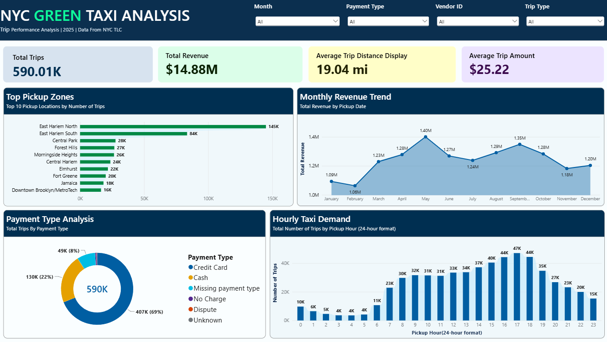

# NYC Green Taxi Analytics | 2025

An end-to-end data analytics project using **PySpark, Databricks Community Edition, Delta Lake, SQL, and Power BI** to process and analyze NYC Green Taxi trip data.

## Dashboard Preview



## Project Overview

This project analyzes 2025 NYC Green Taxi trip records using the Medallion Architecture (Bronze, Silver, Gold). The objective is to transform raw trip data into structured analytical datasets and build an interactive Power BI dashboard to explore taxi demand, revenue trends, payment behavior, and pickup-zone performance.

## Architecture

**Data Source → Bronze → Silver → Gold → Power BI**

- **Bronze:** Loaded monthly Parquet files into Databricks persistent storage.
- **Silver:** Cleaned and transformed trip records using PySpark, derived analytical columns, and performed data-quality checks.
- **Gold:** Created analytical tables for business reporting and dashboard consumption.
- **Power BI:** Built an interactive dashboard using DAX measures, dimensional relationships, KPI cards, charts, and slicers.

## Dataset

- Dataset: NYC Green Taxi Trip Records
- Year: 2025
- Files loaded: 12 monthly Parquet files
- Initial records: 591,375
- Final Silver records: 590,010
- Net reduction: 1,365 records (approximately 0.23%)

## Data Processing & Quality

Using PySpark, the project includes:

- Data cleaning and structural transformations.
- Derived columns such as pickup date, pickup hour, and trip duration.
- Data enrichment through joins with location and payment lookup datasets.
- Validation of missing timestamps and invalid trip distances.
- Investigation of suspicious trip-distance records.

The final Silver dataset contains 590,010 records. The 1,365-record reduction represents the net difference between the initial Bronze count and final Silver count; suspicious-distance records were also investigated separately.

## Dimensional Modeling

Created five dimension tables to support analytical reporting:

| Dimension | Purpose |
|---|---|
| `dim_date` | Date-based analysis |
| `dim_location` | Pickup and drop-off location analysis |
| `dim_payment_type` | Payment method analysis |
| `dim_vendor` | Vendor-level analysis |
| `dim_trip_type` | Trip category analysis |

These dimensions were connected to the `silver_trips` fact table through Power BI relationships to support interactive filtering and reporting.

## Power BI Dashboard

The dashboard includes:

**Key Performance Indicators**
- Total Trips
- Total Revenue
- Average Trip Distance
- Average Trip Amount

**Visualizations**
- Hourly Taxi Demand
- Daily Revenue Trend
- Payment Type Analysis
- Top 10 Pickup Zones

**Interactive Slicers**
- Month
- Payment Type
- Vendor ID
- Trip Type

## Technology Stack

- **Programming:** Python, SQL, PySpark
- **Data Processing:** Apache Spark, Databricks Community Edition
- **Storage & Format:** Databricks Persistent Storage, Parquet, Delta Lake
- **Architecture:** Medallion Architecture
- **Visualization:** Power BI, DAX
- **Data Modeling:** Fact and Dimension Tables

## Repository Structure

```text
nyc-green-taxi-analytics/
│
├── notebooks/
│   └── NYC_Green_Taxi_Analytics.ipynb
│
├── dashboard/
│   ├── NYC_Green_Taxi_Analytics.pbix
│   └── dashboard_preview.png
│
├── docs/
│
└── README.md
```

## How to Explore the Project

1. Open the Databricks notebook to explore the ingestion, transformation, validation, and analytical workflows.
2. Open the Power BI `.pbix` file using Power BI Desktop to explore the dashboard and data model.
3. Refer to the dashboard preview above for a quick overview.

**Note:** The notebook was developed using Databricks Community Edition. Its workspace-specific paths may need to be adjusted when running it in another environment. The original monthly Parquet datasets are not included in this repository.

## Author

**Mohd Mohiuddin**

- GitHub: https://github.com/mohd-mohi-uddin
- LinkedIn: https://linkedin.com/in/mohd-mohiuddin-4557a9335
